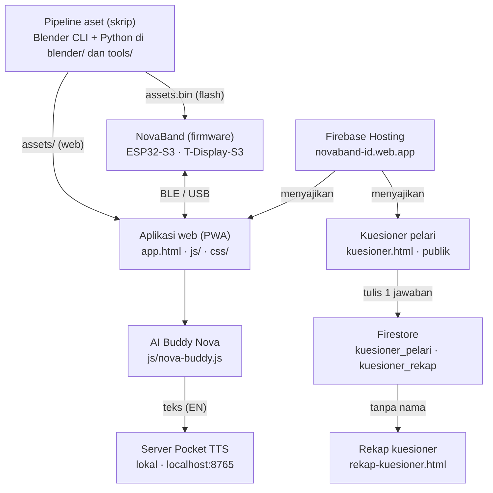

# SOP Penggunaan Proyek NovaBand

Disusun 2026-10-11. Pelengkap [README.md](../README.md) dan [TEKNISI.md](TEKNISI.md).

## 1. Tujuan dan ruang lingkup

SOP ini menjadi pegangan anggota tim dan teknisi untuk menjalankan, memuat (flash), dan memelihara proyek Nova-Band dari repositori `novaband`, tanpa harus menebak urutan langkahnya.

**Nova-Band** adalah wearable lengan atas berbasis AIoT untuk memantau detak jantung dan performa lari secara real-time (proyek ISIF 2026, SMA Negeri 1 Surakarta). Repositori ini memuat enam bagian yang berdiri sendiri:

- **Situs dan aplikasi web (PWA):** profil perusahaan (`index.html`) dan dashboard pelari (`app.html`), di-deploy ke Firebase Hosting.
- **Firmware purwarupa:** kode ESP32-S3 untuk LILYGO T-Display-S3 Touch, beserta simulator PC.
- **Casing cetak 3D:** parameter, sketsa, dan model STL/STEP.
- **Kuesioner pelari:** formulir publik dan halaman rekap admin.
- **Aset dan media:** model 3D, maskot Nova, video, dan deck presentasi yang dibangkitkan lewat skrip.
- **Berkas surat:** generator surat permohonan dan dukungan untuk institusi mitra.

SOP ini **tidak** membahas keputusan desain produk atau isi materi presentasi; untuk penjelasan teknis lebih dalam rujuk `README.md` dan `docs/TEKNISI.md`.

## 2. Gambaran sistem

Aplikasi web adalah satu-satunya pintu ke band; kuesioner dan AI Buddy berjalan terpisah, dan semua aset dibangkitkan skrip, bukan diedit tangan.



Protokol band dan aplikasi sama di Bluetooth dan USB: satu objek JSON per baris, telemetri 1 Hz dan gelombang PPG 50 Hz (definisi di `firmware/novaband_display/src/protocol.h`). Pocket TTS hanya dipakai untuk suara bahasa Inggris; suara bahasa Indonesia memakai suara bawaan browser.

## 3. Persiapan

Alat yang dibutuhkan tergantung kegiatannya; untuk sekadar memakai aplikasi web cukup browser, sedangkan flash dan build firmware butuh toolchain Arduino. Kolom terakhir adalah hasil pengecekan di laptop proyek ini pada 11 Oktober 2026.

| Kegiatan | Yang dibutuhkan | Status di laptop ini |
| --- | --- | --- |
| Memakai aplikasi web | Chrome atau Edge (untuk Bluetooth dan USB), internet | Tidak perlu instalasi |
| Flash firmware siap pakai | `arduino-cli` + core `esp32:esp32` 3.x (menyediakan esptool), kabel USB-C yang membawa data | Siap: `arduino-cli`, core 3.3.11 |
| Build firmware | Ditambah library ArduinoJson 7.x, Python 3 dengan `numpy`, `Pillow`, `qrcode`, serta folder `build/` berisi render aset | ArduinoJson 7.4.3 ada; Python belum terpasang (hanya pintasan Microsoft Store) |
| Simulator UI di PC | Visual Studio 2022 dengan komponen C++ desktop | Belum diperiksa |
| Server lokal, kuesioner, TTS | Python 3 (`tools/serve.py`, `tools/kuesioner-export.py`, `tools/nova-tts-server.py`) | Python belum terpasang |
| Deploy web | Node.js + Firebase CLI, login dengan akses project `novaband-id` | Node dan `firebase` ada; status login belum diperiksa |
| Aset 3D, video, maskot | Blender 4.0, ffmpeg, Python | Blender dan ffmpeg tidak ditemukan |
| Deck presentasi | Node 20, `npm install` di folder `deck/` | Node ada |
| Casing | LibreCAD, FreeCAD 1.x, Python + `ezdxf`, `PyMuPDF` | Belum diperiksa |

**Berkas rahasia lokal.** `firmware/novaband_display/secrets.h` memuat nama Wi-Fi, kata sandi Wi-Fi, serta email, kata sandi, dan peran akun cloud (`WIFI_SSID`, `WIFI_PASS`, `CLOUD_EMAIL`, `CLOUD_PASS`, `CLOUD_ROLE`). Berkas ini tidak masuk git dan **tidak boleh di-commit**. Di cabang `main`, `novaband_display.ino` belum meng-include-nya; berkas ini dipakai fitur pembacaan sensor lewat cloud di cabang `fitur/sensor-max30102-gy50-mlx90614`.

**Sebelum mulai bekerja:**

- [ ] `git status` bersih, atau Anda tahu persis perubahan mana yang belum di-commit.
- [ ] Untuk flash: board T-Display-S3 tercolok dan port COM terbaca (`arduino-cli board list`).
- [ ] Untuk build aset: folder `build/` ada dan berisi hasil render (folder ini tidak ikut git).
- [ ] Untuk deploy atau ekspor data: sudah login (`firebase login`) ke akun yang punya akses.

## 4. Prosedur penggunaan

Setiap prosedur berdiri sendiri; kerjakan hanya yang sesuai kebutuhan. Semua perintah dijalankan dari folder utama repositori (`novaband/`).

### 4.1 Memakai aplikasi web

1. Buka <https://novaband-id.web.app/app.html>. Untuk menjalankan salinan lokal: `python tools/serve.py 5175`, lalu buka `http://localhost:5175/app.html`. Pakai server ini, bukan `python -m http.server`, karena service worker butuh tipe MIME `text/javascript`.
2. Klik **Hubungkan** di bilah atas dan pilih salah satu: **Bluetooth** (Chrome/Edge di Android, Windows, macOS), **Kabel USB** (Chrome/Edge desktop), atau **Mode simulasi** (tanpa perangkat, data contoh).
3. Untuk Bluetooth atau USB, nyalakan band dulu hingga layarnya menampilkan **READY TO PAIR** di halaman Link.
4. Di **Beranda**, klik **Mulai Sesi** untuk memulai sesi lari; label tombol berganti menjadi Jeda Sesi, lalu Lanjutkan setelah dijeda; **Reset** mengembalikan sesi.
5. Jelajahi enam panel: Beranda, Aktivitas, Performa, Komunitas, Perangkat, Akun.
6. Di panel **Perangkat** Anda bisa mengirim pesan ke layar band (maksimal 40 karakter), mengatur kecerahan, memilih halaman yang tampil di band, dan mengatur ambang peringatan detak jantung, beban jaringan lunak, dan readiness.
7. Di panel **Akun**, lihat profil fisiologis (saat ini profil demo dengan data simulasi); begitu terhubung, profil dan jam perangkat dikirim otomatis ke band sebagai perintah `hello`.
8. Klik **Pasang** bila muncul untuk memasang aplikasi sebagai PWA.

iPhone (Safari) tidak mendukung Web Bluetooth maupun Web Serial, jadi hanya mode simulasi yang tersedia. Web Bluetooth dan Web Serial juga hanya berjalan di HTTPS atau `localhost`.

### 4.2 Memakai band (layar dan tombol)

Band punya empat halaman: **LIVE** (detak jantung, jantung 3D, gelombang PPG), **RUN**, **READINESS**, dan **LINK** (status pairing + QR ke aplikasi). Geser layar sentuh untuk berpindah halaman.

| Tombol | Tekan singkat | Tekan lama |
| --- | --- | --- |
| KEY (GPIO 14) | Halaman berikutnya | Mulai atau jeda lari |
| BOOT (GPIO 0) | Halaman sebelumnya | Simpan lari |

Tanda **DEMO** di layar berarti detak jantung masih simulasi, karena board T-Display-S3 tidak punya sensor PPG.

### 4.3 Flash firmware ke board

**Tanpa build (memakai biner siap pakai):**

```powershell
powershell -ExecutionPolicy Bypass -File firmware\flash.ps1 -Prebuilt
```

**Dengan build dari sumber:**

```powershell
arduino-cli lib install ArduinoJson
powershell -ExecutionPolicy Bypass -File firmware\flash.ps1              # build aset + compile + flash aplikasi dan aset
powershell -ExecutionPolicy Bypass -File firmware\flash.ps1 -AppOnly     # hanya aplikasi
powershell -ExecutionPolicy Bypass -File firmware\flash.ps1 -SkipBuild -AppOnly   # flash ulang tanpa compile
```

1. Colokkan board lewat USB-C. Port dicari otomatis; paksa dengan `-Port COM11` bila perlu.
2. Bila gagal masuk mode download: tahan **BOOT**, tekan **RST**, lepas BOOT, lalu ulangi.
3. Pantau log serial: `arduino-cli monitor -p COM11 -c baudrate=115200`. Baris diawali `#`; tiap 5 detik muncul `# fps ... render ... ms heap ...`.
4. Bila `src/asset_ids.h` berubah, flash **aset dan aplikasi bersamaan** (jangan `-AppOnly`); firmware menolak paket aset yang tidak cocok.
5. Setelah mengubah firmware, perbarui isi `firmware/prebuilt/` agar rekan tanpa toolchain tetap mendapat versi terbaru.

Firmware pabrik LILYGO dapat dipulihkan dari cadangan di mesin pengembang: `esptool --port COM11 write-flash 0 build\firmware-backup\original_16MB.bin`.

### 4.4 Menguji tampilan tanpa board (simulator)

```bat
firmware\sim\build.bat
firmware\sim\sim.exe firmware\prebuilt\assets.bin build\sim 30
```

Hasilnya 750 frame skenario 25 detik. Baris terakhir harus mencetak `band mismatches 0`; artinya render dua pita identik dengan render penuh.

### 4.5 Mencetak casing

1. Ukur board dengan jangka sorong; sesuaikan `BOARD_*`, `GLASS_*`, `BTN_*` di `hardware/casing/case_params.py` bila berbeda dari nilai nominal (62 × 26 × 10 mm).
2. `python hardware/casing/sketch_dxf.py` untuk gambar kerja DXF, lalu `freecadcmd hardware/casing/case_freecad.py` untuk STL dan STEP di `hardware/casing/out/`.
3. Cetak dengan PETG atau ASA, layer 0,2 mm, tanpa support, kedua bagian menghadap bawah pada sambungan; tutup tombol dicetak berdiri.
4. Rakit: board ke baki, tutup tombol ke lubangnya, pasang tutup, kunci dengan 4 sekrup M2 × 8 dari bawah. Strap 38–40 mm lewat terowongan di bawah board.

### 4.6 Kuesioner pelari dan rekapnya

- **Mengisi:** bagikan `kuesioner.html` (atau QR di `assets/img/kuesioner-qr.png`); lama pengisian sekitar 5 menit. Jawaban masuk ke koleksi Firestore `kuesioner_pelari`, dan salinan tanpa nama ke `kuesioner_rekap`.
- **Melihat rekap:** buka `rekap-kuesioner.html` (tanpa login, nama tidak pernah ditampilkan, tidak diindeks mesin pencari). Tombol **Unduh CSV** mengekspor tabel jawaban.
- **Ekspor lengkap ke Excel:** `python tools/kuesioner-export.py` menghasilkan `.xlsx` dan `.csv` di `data/kuesioner/`. Butuh kredensial admin (`firebase login` atau login gcloud). Entri uji (nama berawalan "UJI COBA" atau saran berawalan "[UJI]") dilewati.

### 4.7 AI Buddy (chat dengan Nova)

1. Di `app.html`, klik tombol bulat Nova di kanan bawah untuk membuka chat. Ia menjawab dari data live aplikasi dan bisa memulai atau menjeda sesi. Pertanyaan darurat (nyeri dada, sesak napas, mau pingsan) selalu diprioritaskan: Nova menyuruh berhenti dan menghubungi 112/119.
2. Suara bahasa Indonesia memakai suara bawaan HP atau browser; tidak perlu persiapan.
3. Untuk suara bahasa Inggris dengan Pocket TTS di laptop: `pip install pocket-tts`, lalu `python tools/nova-tts-server.py` (port 8765, CPU; model diunduh pada run pertama). Aplikasi mendeteksinya otomatis dan menampilkan label "Voice: Pocket TTS".

Tidak ada LLM cloud; teks hanya dikirim ke server TTS lokal.

### 4.8 Deploy situs ke Firebase Hosting

1. Uji lokal dengan `python tools/serve.py 5175`.
2. Bila Anda mengubah berkas yang di-cache aplikasi (daftar `SHELL` di `sw.js`), naikkan `VERSION` di `sw.js` agar cache lama terhapus.
3. Jalankan `firebase deploy --only hosting --project novaband-id`.
4. Aturan Firestore dideploy terpisah: `firebase deploy --only firestore:rules --project novaband-id`.

Folder dan berkas ini otomatis tidak ikut ter-upload: `ppt/`, `build/`, `blender/`, `tools/`, `deck/`, `firmware/`, `hardware/`, `berkas/`, `docs/`, serta `*.md`, `*.pdf`, `*.docx`, `*.pptx`, `*.py`.

### 4.9 Membangun ulang aset, video, dan deck

Semua isi `assets/` dibangkitkan skrip; jangan diedit manual, jalankan ulang skripnya. Perintah lengkap dan urutannya ada di `README.md`.

| Hasil | Perintah utama |
| --- | --- |
| Model 3D untuk viewer (`assets/novaband.glb`) | `blender -b -P blender/novaband_model.py -- --no-render` |
| 46 aset 3D (`assets/3d/*.webp`) | `blender -b -P blender/novaband_assets.py`, lalu `python tools/pack-assets.py` |
| Showreel | `blender -b -P blender/novaband_reel3d.py`, lalu `python tools/make-showreel.py` |
| Maskot Nova (klip dan lembar karakter) | `python blender/mascot_anim.py --anim all`, lalu `python tools/make-mascot-webp.py` |
| Aset layar firmware (`build/fw/assets.bin`) | `python tools/fw_assets.py` |
| Deck PowerPoint | `cd deck && npm install && node build-deck.js`, lalu `python deck/animate-deck.py` |
| Surat permohonan dan dukungan | skrip `berkas/make_surat_*.py` dan `berkas/make_konsep_yogya.py` (hasilnya hanya disimpan lokal) |

## 5. Pemeliharaan dan keamanan data

Repositori ini publik, jadi aturan terpenting adalah tidak ada rahasia dan data pribadi yang ikut ter-commit.

**Alur kerja git**

1. Kerjakan di cabang (`fitur/...` atau `perbaikan/...`), lalu buka Pull Request ke `main`.
2. Jangan commit hasil render besar atau `.pptx`; lampirkan di GitHub Release bila perlu dibagikan.
3. Setelah mengubah firmware, perbarui `firmware/prebuilt/`.
4. Setelah mengubah halaman yang di-cache aplikasi, naikkan `VERSION` di `sw.js` sebelum deploy.

**Yang tidak boleh masuk git**

| Berkas atau folder | Isi | Penjaga |
| --- | --- | --- |
| `firmware/novaband_display/secrets.h` | Wi-Fi dan akun cloud | Belum ada di `.gitignore`; jangan di-`git add` |
| `build/sketchfab/.token`, `*.token`, `.env` | Token API | `.gitignore` |
| `data/` | Hasil ekspor kuesioner (jawaban responden) | `.gitignore` |
| `kartu-nama/`, `berkas/mersif/`, `berkas/_preview/` | Kontak pribadi dan pratinjau surat | `.gitignore` |
| `build/` | Render, unduhan Sketchfab, cadangan firmware pabrik | `.gitignore` |

Kunci web Firebase di `js/firebase-init.js` memang publik; yang melindungi data adalah `firestore.rules`. Aturan itu hanya mengizinkan *menambah* satu jawaban kuesioner, tidak ada yang bisa membaca, mengubah, atau menghapus dari browser.

**Cadangan.** Folder `build/` tidak ada di git, jadi salin secara berkala ke penyimpanan lain: render Blender, unduhan Sketchfab beserta `credits.json`, dan `build/firmware-backup/original_16MB.bin` (firmware pabrik LILYGO, satu-satunya jalan kembali bila board perlu dipulihkan).

**Lisensi aset.** Model Sketchfab berlisensi CC-BY. Setiap aset baru harus tercatat di `credits.json` (otomatis lewat `python tools/sketchfab.py get <uid> <nama>`) dan di slide kredit deck.

**Data responden.** Jawaban kuesioner bersifat pribadi. Halaman rekap tidak menampilkan nama, dan berkas hasil ekspor tidak boleh dibagikan atau di-commit.

## 6. Pemecahan masalah

Periksa baris log serial yang diawali `#` lebih dulu; hampir semua gejala firmware meninggalkan jejak di sana.

| Gejala | Kemungkinan penyebab | Tindakan |
| --- | --- | --- |
| `flash.ps1` berkata "No ESP32 board found" atau gagal menulis | Kabel USB hanya untuk daya, atau board tidak dalam mode download | Pakai kabel data. Tahan **BOOT**, tekan **RST**, lepas BOOT, ulangi. Tentukan port dengan `-Port COM11` |
| Compile gagal di baris pertama `novaband_display.ino` | Di salinan kerja saat ini (belum di-commit) baris 1 berawalan huruf `s` sebelum `// ====`, sisa ketikan | Hapus huruf `s` di awal baris 1 |
| Layar merah anggur dan pesan di serial setelah flash | `asset_ids.h` tidak cocok dengan `assets.bin` yang ada di flash | Flash aset dan aplikasi bersamaan (tanpa `-AppOnly`) |
| Geser layar sentuh terbalik | Orientasi sentuh CST816 | Ubah `TOUCH_FLIP_X` di `novaband_display.ino`; lihat koordinat mentah di serial (`# touch raw`) |
| Layar patah-patah, tombol tidak responsif | Core 0 jenuh, mungkin oleh tugas WiFi atau cloud di cabang sensor; penyebab pastinya belum terbukti | Ikuti `firmware/novaband_display/TUGAS-CLAUDE-lag-tombol.md`: catat `# fps`, `# mem`, `# cloud`, lalu bisect dengan mengomentari `cloud::watch("esp32c3")` |
| Detak jantung bertanda `DEMO` | Board tidak punya sensor PPG; nilai disimulasikan | Normal. Untuk sensor sungguhan panggil `model.setRealHr(bpm, uptime())` atau kirim `{"cmd":"hr","v":...}` |
| Pilihan Bluetooth atau USB tidak berfungsi | Browser tidak didukung (Safari iOS), halaman bukan HTTPS atau `localhost`, atau band belum menampilkan READY TO PAIR | Pakai Chrome atau Edge, buka lewat HTTPS atau `localhost`, atau pakai mode simulasi |
| Konsol: "MIME type text/plain" untuk `firebase-init.js` | Server `python -m http.server` di Windows | Pakai `python tools/serve.py 5175`; di Firebase Hosting tidak terjadi |
| Tampilan lama muncul setelah deploy | Cache service worker | Naikkan `VERSION` di `sw.js`, deploy ulang, lalu muat ulang keras |
| Nova berbicara Inggris dengan suara browser, bukan Pocket TTS | Server TTS tidak berjalan | Jalankan `python tools/nova-tts-server.py`; cek `http://localhost:8765/health` |
| `kuesioner-export.py` ditolak | Belum login admin, atau akun tak punya akses ke `novaband-id` | `firebase login` dengan akun yang berhak, lalu ulangi |
| Render Blender berhenti di tengah klip | Blender 4.0 kadang crash | Driver mengulang otomatis; jangan jalankan dua driver sekaligus (frame saling menimpa) |
| `python` tidak ditemukan atau membuka Microsoft Store | Python belum terpasang, hanya pintasan Store | Pasang Python 3 (centang "Add to PATH") lalu ulangi |
